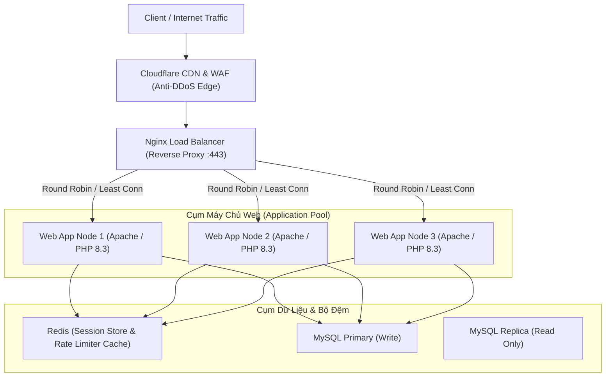

# KỊCH BẢN KIỂM THỬ BẢO MẬT & TẤN CÔNG ĐÁNH GIÁ AN TOÀN HỆ THỐNG
**Dự án:** Sàn Thương Mại Điện Tử IntegrityMarket  
**Đồ án:** An Toàn Thương Mại Điện Tử - Nhóm 11  
**Mục tiêu:** Hướng dẫn thành viên phụ trách bảo mật trong nhóm thực hiện quy trình kiểm thử từ bên ngoài (Black-box & Gray-box Pentest) bằng các công cụ chuyên dụng, đối chiếu với chuẩn OWASP Top 10 và trình bày giải pháp chống DoS/DDoS, Cân bằng tải (Load Balancer).

---

## TỔNG QUAN MÔI TRƯỜNG KIỂM THỬ (TARGET SCOPE)
* **Mục tiêu kiểm thử (Target URL):** `https://192.168.1.54` hoặc `https://shop.itgslab.io.vn` (Cổng 443 HTTPS chuẩn bảo mật với HSTS, Cookie Secure & TLS 1.2/1.3; Cổng 80/8080 tự động 301 chuyển hướng HTTPS).
* **Môi trường:** Máy chủ Apache 2.4, PHP 8.3, MariaDB (MySQL), Kiến trúc MVC.
* **Máy kiểm thử (Attacker Machine):** Máy tính của thành viên nhóm (khuyến nghị chạy Kali Linux, Parrot OS hoặc Windows đã cài sẵn Nmap, Burp Suite, OWASP ZAP, sqlmap).

---

## GIAI ĐOẠN 1: DO THÁM & THU THẬP THÔNG TIN (RECONNAISSANCE & FOOTPRINTING)

Mục đích: Tìm hiểu bề mặt tấn công (Attack Surface), phát hiện các cổng mở, phiên bản dịch vụ và các file/thư mục nhạy cảm.

### 1. Quét Cổng & Nhận Diện Dịch Vụ Bằng Nmap
Chạy trên terminal của máy kiểm thử:
```bash
# Quét các cổng mở phổ biến và lấy thông tin phiên bản chi tiết:
nmap -sV -sC -p 80,443,8080,3306 192.168.1.54 -oN nmap_report.txt
```
* **Kỳ vọng kết quả:**
  * Cổng `8080/tcp`: Apache httpd 2.4 (mở phục vụ web).
  * Cổng `3306/tcp`: MariaDB (chỉ lắng nghe localhost `127.0.0.1` hoặc bị chặn bởi firewall `ufw`, không được để lộ public ra ngoài).

### 2. Định Danh Công Nghệ Web (Fingerprinting)
```bash
# Sử dụng WhatWeb:
whatweb http://192.168.1.54:8080
```
* Phân tích các tiêu đề HTTP (Headers): `Server: Apache`, `X-Powered-By: PHP/8.3`.

### 3. Dò Quét Lỗi Cấu Hình Web Bằng Nikto
```bash
nikto -h http://192.168.1.54:8080 -o nikto_scan.html -Format htm
```
* Kiểm tra các cấu hình:
  * Thiếu tiêu đề bảo mật (`X-Frame-Options`, `X-Content-Type-Options`, `Content-Security-Policy`).
  * Kiểm tra các file nhạy cảm thường gặp (`.git`, `.env`, `phpinfo.php`).

### 4. Quét Thư Mục Và Tệp Ẩn Bằng Gobuster / Dirsearch
```bash
# Quét bằng gobuster với từ điển đường dẫn phổ biến:
gobuster dir -u http://192.168.1.54:8080 -w /usr/share/wordlists/dirb/common.txt -x php,html,txt,sql -t 20
```
* Kiểm tra xem các file backup (`backup.sql`, `config.php.bak`) có bị lộ hay không.

---

## GIAI ĐOẠN 2: DÒ QUÉT LỖ HỔNG TỰ ĐỘNG (AUTOMATED VULNERABILITY SCANNING)

### 1. Dò Quét Bằng OWASP ZAP (Zed Attack Proxy)
1. Mở **OWASP ZAP**.
2. Nhập URL mục tiêu: `http://192.168.1.54:8080`.
3. Bấm **Attack** -> Chọn chế độ **Automated Scan**:
   * **Bước 1 (ZAP Spider):** Thu thập toàn bộ cây thư mục URL của website (`/index.php`, `/index.php?page=cart`, `/index.php?page=checkout`, `/index.php?page=login`).
   * **Bước 2 (Active Scan):** Bơm tự động hàng ngàn payload kiểm tra XSS, SQLi, Path Traversal, Command Injection.
4. Xuất báo cáo: **Generate Report** -> Chọn HTML Report để đính kèm vào phụ lục đồ án.

### 2. Đánh Chặn & Phân Tích Gói Tin Bằng Burp Suite
1. Bật **Burp Suite Community / Professional**, cấu hình proxy trình duyệt trỏ qua `127.0.0.1:8080`.
2. Duyệt qua các tính năng của sàn: Đăng ký tài khoản, Đăng nhập, Thêm giỏ hàng, Thanh toán.
3. Trong tab **Target -> Site map**: Quan sát các endpoint nhạy cảm (`index.php?page=checkout`, `index.php?page=simulate-webhook`).
4. Sử dụng tab **Repeater** để thử can thiệp vào các tham số (Parameter Tampering).

---

## GIAI ĐOẠN 3: KIỂM THỬ KHAI THÁC CÓ KIỂM SOÁT (EXPLOITATION TESTING THEO OWASP TOP 10)

Thực hiện các kịch bản tấn công thực tế và chứng minh cơ chế phòng thủ của hệ thống:

### 1. Kiểm Thử Lỗ Hổng SQL Injection (SQLi - OWASP A03)
* **Mục tiêu:** Thử khai thác cơ sở dữ liệu MySQL qua các tham số đầu vào.
* **Thực hiện bằng `sqlmap`:**
  ```bash
  sqlmap -u "http://192.168.1.54:8080/index.php?page=product&id=1" --batch --dbs --risk=3 --level=3
  ```
* **Thử nghiệm thủ công trên form Đăng nhập / Tìm kiếm:**
  * Payload: `' OR '1'='1' -- ` hoặc `' UNION SELECT null, username, password FROM users -- `
* **Kết quả & Minh chứng bảo mật:**
  * `sqlmap` báo kết quả: `all tested parameters appear to be not injectable`.
  * **Giải thích kỹ thuật:** Hệ thống sử dụng 100% **PDO Prepared Statements** với tham số hóa (Parameterized Queries). Câu lệnh SQL được biên dịch trước, dữ liệu người dùng nhập vào luôn được xử lý như một chuỗi thuần túy (String Literal), vô hiệu hóa hoàn toàn SQL Injection.

### 2. Kiểm Thử Lỗ Hổng Cross-Site Scripting (XSS - OWASP A03)
* **Mục tiêu:** Chèn mã JavaScript độc hại vào trang web.
* **Thực hiện kiểm thử:**
  * Trên ô Tìm kiếm: `http://192.168.1.54:8080/index.php?q=<script>alert('XSS')</script>`
  * Trên form Đăng ký người dùng / Thêm sản phẩm / Bình luận:
    ```html
    
    ```
* **Kết quả & Minh chứng bảo mật:**
  * Mã JavaScript không thực thi mà được hiển thị dạng ký tự văn bản thông thường.
  * **Giải thích kỹ thuật:** Toàn bộ dữ liệu hiển thị trên giao diện người dùng đều được bọc qua hàm `htmlspecialchars($data, ENT_QUOTES, 'UTF-8')`. Ký tự `<` bị chuyển thành `&lt;`, `>` thành `&gt;`, ngăn chặn mã độc chạy trên trình duyệt. Cookie của người dùng cũng được cấu hình cờ `HttpOnly; SameSite=Strict`.

### 3. Kiểm Thử Lỗ Hổng Phân Quyền IDOR (Insecure Direct Object References - OWASP A01)
* **Mục tiêu:** Thử truy cập đơn hàng của khách hàng khác bằng cách thay đổi ID.
* **Thực hiện kiểm thử:**
  * Mở trình duyệt xem đơn hàng của mình: `index.php?page=order-tracking&id=a1b2c3d4-e5f6...`
  * Thử đoán ID số tuần tự: `index.php?page=order-tracking&id=1` hoặc `id=2`.
* **Kết quả & Minh chứng bảo mật:**
  * Hệ thống sử dụng **UUID phiên bản v4 (128-bit ngẫu nhiên)** cho khóa chính đơn hàng thay vì ID tự tăng (Auto Increment). Kẻ tấn công không thể quét hoặc đoán ID.
  * Trong tầng nghiệp vụ (`OrderService`), hệ thống kiểm tra logic `user_id` trong Session hiện tại phải trùng khớp với người đặt đơn hàng, nếu không sẽ từ chối hiển thị.

### 4. Kiểm Thử Tấn Công Giả Mạo Yêu Cầu (CSRF - OWASP A01)
* **Mục tiêu:** Tạo một trang web độc hại từ domain khác ép người dùng đổi mật khẩu hoặc đặt hàng lén lút.
* **Thực hiện kiểm thử:**
  * Dựng 1 file HTML giả mạo submit POST request tới `http://192.168.1.54:8080/index.php?page=checkout` mà không có mã token CSRF.
* **Kết quả & Minh chứng bảo mật:**
  * Máy chủ trả về lỗi `403 Forbidden - CSRF Token Invalid`.
  * **Giải thích kỹ thuật:** Mọi biểu mẫu POST đều bắt buộc phải kèm trường `csrf_token` được sinh ngẫu nhiên theo từng phiên làm việc (`CsrfService::validate()`).

### 5. Kiểm Thử Tấn Công Giả Mạo Thanh Toán & Webhook (Payment Tampering)
* **Kịch bản A: Sửa đổi số tiền đơn hàng (Price Tampering):**
  * Dùng Burp Suite bắt gói tin submit giỏ hàng, sửa số tiền từ `10.000.000 đ` xuống `1.000 đ`.
  * *Kết quả:* Máy chủ tính toán lại tổng tiền độc lập dựa trên giá lưu trong database, không tin tưởng số tiền gửi lên từ phía client.
* **Kịch bản B: Giả mạo phản hồi VNPAY Return / Webhook:**
  * Thử gửi request giả mạo `vnp_ResponseCode=00` nhưng tự chế chuỗi `vnp_SecureHash`.
  * *Kết quả:* Máy chủ tính lại HMAC-SHA512 bằng khóa bí mật `vnp_HashSecret`, phát hiện chữ ký không khớp và hủy giao dịch ngay lập tức.

---

## GIAI ĐOẠN 4: KIỂM THỬ CHỊU TẢI & PHÂN TÍCH GIẢI PHÁP CHỐNG DoS/DDoS, LOAD BALANCER

Trong báo cáo đồ án, giảng viên luôn yêu cầu trình bày phương án hệ thống xử lý khi bị tấn công từ chối dịch vụ (DoS/DDoS) và phân tải.

### 1. Kiểm Thử Tải (Stress Testing) Bằng Apache Benchmark (`ab`)
Chạy lệnh từ máy tấn công:
```bash
# Bắn 5000 requests với 100 kết nối đồng thời:
ab -n 5000 -c 100 http://192.168.1.54:8080/index.php
```
* **Đánh giá các chỉ số:**
  * `Requests per second (RPS)`: Tốc độ xử lý của máy chủ.
  * `Failed requests`: Tỷ lệ yêu cầu bị rớt kết nối khi chịu áp lực cao.

### 2. Thử Nghiệm Tấn Công DoS Lớp Ứng Dụng (Slowloris / Slow HTTP Attack)
* Tấn công Slowloris giữ hàng nghìn kết nối HTTP mở dở dang bằng cách gửi header cực chậm, làm cạn kiệt Connection Pool (MaxClients / MaxRequestWorkers) của Apache.
* Lệnh kiểm thử bằng công cụ `slowhttptest`:
  ```bash
  slowhttptest -c 500 -H -g -o slow_loris_result -i 10 -r 200 -t GET -u http://192.168.1.54:8080/index.php -x 24 -p 3
  ```

---

## GIẢI PHÁP PHÒNG THỦ DoS/DDoS & KIẾN TRÚC CÂN BẰNG TẢI (LOAD BALANCER)

Để trả lời câu hỏi của hội đồng: *"Hệ thống của em làm thế nào để chống lại tấn công DDoS và chịu được lượng truy cập lớn?"*, các bạn trình bày theo 2 lớp kiến trúc sau:

### Lớp 1: Phòng Thủ DDoS Tại Biên Mạng (Edge Defense với Cloudflare WAF/CDN)
* **Cơ chế Anycast DNS & BGP Routing:** Mọi luồng truy cập đi qua mạng lưới hàng trăm Data Center toàn cầu của Cloudflare để hấp thụ lưu lượng DDoS tầng mạng (Layer 3 & 4: SYN Flood, UDP Amplification lên đến hàng Terabits).
* **Cloudflare Under Attack Mode:** Tự động kích hoạt thử thách JavaScript Challenge / Managed Challenge (hCaptcha) khi phát hiện lượng truy cập đột biến bất thường, loại bỏ 99.9% botnet tự động.
* **Rate Limiting:** Giới hạn mỗi địa chỉ IP chỉ được gửi tối đa 30 requests/phút vào các endpoint nhạy cảm như `/index.php?page=login` hoặc `/index.php?page=checkout`.

### Lớp 2: Kiến Trúc Cân Bằng Tải (Reverse Proxy & Load Balancer)

Khi mở rộng quy mô sản xuất (Production), kiến trúc triển khai bao gồm một cụm máy chủ đứng sau **Nginx Load Balancer** hoặc **HAProxy**:



#### Cấu Hình Mẫu Nginx Load Balancer & Rate Limiting:
```nginx
# Định nghĩa vùng nhớ giới hạn tần suất request (Rate Limiting)
limit_req_zone $binary_remote_addr zone=one:10m rate=10r/s;

# Khai báo cụm server xử lý phía sau (Upstream Cluster)
upstream attmdt_backend {
    least_conn; # Giải thuật: Chuyển request đến server đang ít kết nối nhất
    server 192.168.1.54:8080 weight=2 max_fails=3 fail_timeout=30s;
    server 192.168.1.55:8080 weight=1 max_fails=3 fail_timeout=30s;
}

server {
    listen 80;
    server_name itgslab.io.vn;

    location / {
        limit_req zone=one burst=20 nodelay; # Áp dụng chống flood request
        proxy_pass http://attmdt_backend;
        proxy_set_header Host $host;
        proxy_set_header X-Real-IP $remote_addr;
        proxy_set_header X-Forwarded-For $proxy_add_x_forwarded_for;
        proxy_connect_timeout 5s;
        proxy_read_timeout 60s;
    }
}
```

* **Lợi ích:**
  1. **High Availability (Sẵn sàng cao):** Nếu 1 server web gặp sự cố hoặc bị quá tải, Load Balancer tự động cô lập (Health Check) và chuyển toàn bộ lưu lượng sang các node còn lại mà khách hàng không bị gián đoạn.
  2. **Chống tràn tài nguyên (Mitigate Slow HTTP):** Nginx tiếp nhận toàn bộ kết nối chậm, gom đủ gói tin hoàn chỉnh mới chuyển vào backend Apache, triệt tiêu hoàn toàn tấn công Slowloris.
  3. **Zero-Downtime Deployment:** Nâng cấp hoặc vá lỗi phần mềm từng node mà không phải tắt sàn thương mại điện tử.
