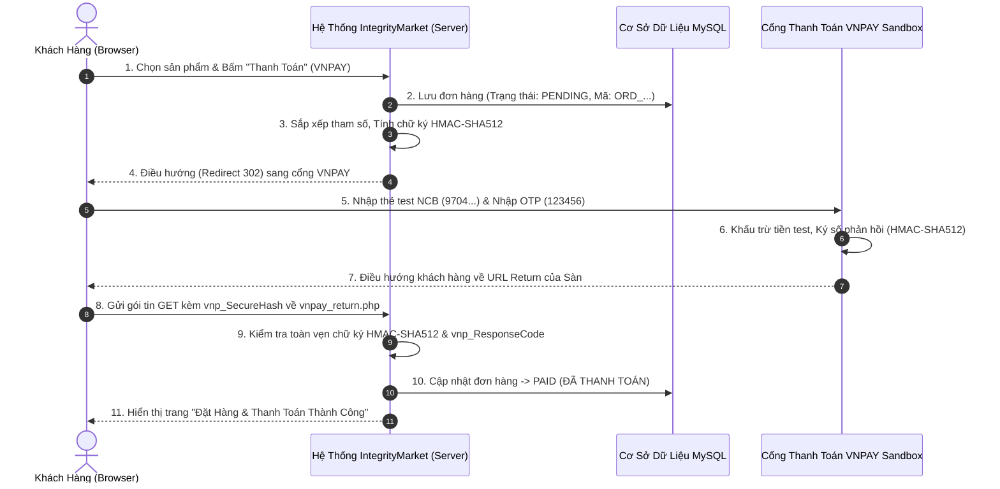

# HƯỚNG DẪN THIẾT LẬP CỔNG THANH TOÁN SANDBOX & QUY TRÌNH XỬ LÝ GIAO DỊCH (PAYMENT GATEWAY WORKFLOW)
**Dự án:** Sàn Thương Mại Điện Tử IntegrityMarket  
**Đồ án:** An Toàn Thương Mại Điện Tử - Nhóm 11  
**Mục đích:** Tài liệu hướng dẫn đăng ký môi trường kiểm thử (Sandbox/Dev), cấu hình mã nguồn và thuyết minh chi tiết luồng giao dịch (Flow) cho giảng viên và hội đồng phản biện.

---

## PHẦN 1: ĐỊA CHỈ ĐĂNG KÝ VÀ QUẢN TRỊ CÁC CỔNG THANH TOÁN TEST (SANDBOX)

Mọi giao dịch trong quá trình nghiệm thu và kiểm thử đồ án đều được thực hiện qua môi trường **Sandbox/Developer** (tiền ảo, thẻ test) của các đơn vị trung gian thanh toán hợp pháp.

### 1. CỔNG THANH TOÁN VNPAY SANDBOX (ĐÃ TÍCH HỢP SẴN TRONG SOURCE CODE)
* **Trang đăng ký tài khoản Merchant Test:** [https://sandbox.vnpayment.vn/devreg/](https://sandbox.vnpayment.vn/devreg/)
  * *Cách đăng ký:* Điền họ tên, số điện thoại, email của bạn. Hệ thống VNPAY sẽ gửi ngay email kích hoạt chứa:
    * **`vnp_TmnCode`** (Mã định danh website của bạn tại VNPAY, ví dụ: `COCOSIN1`, `2QXUI4J4`, hoặc mã riêng được cấp).
    * **`vnp_HashSecret`** (Chuỗi bí mật dùng để băm HMAC-SHA512, dùng để ký dữ liệu truyền đi và đối soát dữ liệu phản hồi).
* **Trang quản trị & tra cứu giao dịch Sandbox (Merchant Portal):** [https://sandbox.vnpayment.vn/merchantv2/](https://sandbox.vnpayment.vn/merchantv2/)
  * Đăng nhập bằng tài khoản và mật khẩu VNPAY gửi qua email.
  * Xem nhật ký mọi giao dịch thanh toán thành công/thất bại, thời gian giao dịch, IP gọi vào, trạng thái đối soát IPN/Return.
* **Thông tin thẻ ATM Test của VNPAY (Ngân hàng NCB):**
  * **Ngân hàng:** `NCB` (Ngân hàng Quốc Dân)
  * **Số thẻ test:** `9704198526191432198`
  * **Tên chủ thẻ:** `NGUYEN VAN A`
  * **Ngày phát hành:** `07/15`
  * **Mật khẩu OTP:** `123456`

---

### 2. CỔNG THANH TOÁN VÍ ĐIỆN TỬ MOMO SANDBOX
* **Cổng nhà phát triển MoMo:** [https://developers.momo.vn](https://developers.momo.vn)
* **Trang tài liệu tích hợp:** [https://developers.momo.vn/v3/vi/docs/payment/onboarding/test-instructions](https://developers.momo.vn/v3/vi/docs/payment/onboarding/test-instructions)
* **Trang quản trị tài khoản MoMo Business Sandbox:** [https://business.momo.vn](https://business.momo.vn)
* **Các tham số cần lấy:**
  * `partnerCode`: Mã đối tác test do MoMo cấp.
  * `accessKey`: Khóa truy cập API.
  * `secretKey`: Khóa bí mật tạo chữ ký HMAC-SHA256.
* **Môi trường test:** Tải ứng dụng **MoMo Test** (dành cho lập trình viên Android/iOS) hoặc quét mã QR mô phỏng để tự động trả về kết quả `resultCode = 0` (thành công).

---

### 3. CỔNG THANH TOÁN VIETQR MỞ - PayOS (DYNAMIC VIETQR)
* **Trang chủ & Cổng đăng ký:** [https://payos.vn](https://payos.vn)
* **Bảng điều khiển quản trị (Dashboard):** [https://my.payos.vn](https://my.payos.vn)
* **Cách thức hoạt động:**
  * PayOS cho phép tạo mã VietQR động chuẩn Napas 24/7 (gồm số tài khoản, số tiền chính xác từng đồng và nội dung chuyển khoản là mã đơn hàng).
  * Hỗ trợ Webhook thông báo biến động số dư tức thời từ ngân hàng về máy chủ website.
* **Các tham số cần lấy:**
  * `Client ID`
  * `API Key`
  * `Checksum Key` (Dùng để kiểm tra tính toàn vẹn chữ ký HMAC của Webhook từ PayOS gửi về).

---

### 4. CỔNG THANH TOÁN QUỐC TẾ PAYPAL SANDBOX (DỰ PHÒNG QUỐC TẾ)
* **Cổng nhà phát triển:** [https://developer.paypal.com](https://developer.paypal.com)
* **Quản trị Sandbox Accounts:** Vào mục **Testing Tools -> Sandbox Accounts**.
  * PayPal tự động tạo sẵn 1 tài khoản **Business** (đại diện người bán) và 1 tài khoản **Personal** (đại diện người mua test) có sẵn số dư $5000 test.
* **Các tham số cần lấy:**
  * Vào mục **Apps & Credentials -> Create App (Sandbox mode)**.
  * Lấy `Client ID` và `Secret Key`.

---

## PHẦN 2: CÔNG VIỆC ĐÃ TRIỂN KHAI TRONG SOURCE CODE (HỆ THỐNG ĐÃ LÀM GÌ?)

Nhóm đã hoàn thành trọn vẹn hạ tầng xử lý thanh toán đa kênh chuẩn bảo mật cấp doanh nghiệp:

1. **Tạo file cấu hình tập trung:**  
   `config/payment_gateways.php`: Quản lý các cấu hình `vnp_Url`, `vnp_TmnCode`, `vnp_HashSecret`, `vnp_ReturnUrl`, cũng như các khóa của MoMo, PayOS và PayPal.
2. **Khởi tạo luồng VNPAY chuẩn HMAC-SHA512 (`PaymentService.php`):**
   * Phương thức `createVnpayPaymentUrl($order, $ip)`:
     * Tự động thu thập các tham số: `vnp_Version = 2.1.0`, `vnp_Command = pay`, `vnp_TmnCode`, `vnp_Amount` (nhân 100 theo chuẩn VNPAY), `vnp_CreateDate` (theo chuẩn GMT+7 `Asia/Ho_Chi_Minh`), `vnp_CurrCode = VND`, `vnp_IpAddr`, `vnp_OrderInfo`, `vnp_ReturnUrl`, `vnp_TxnRef` (mã đơn hàng).
     * Sắp xếp từ điển (Alphabetical Sort theo key) toàn bộ tham số theo yêu cầu kỹ thuật của VNPAY.
     * Tạo chuỗi HashData và ký số bằng thuật toán `hash_hmac('sha512', $hashData, $vnp_HashSecret)`.
     * Điều hướng khách hàng an toàn sang `sandbox.vnpayment.vn/paymentv2/vpcpay.html`.
3. **Đối soát giao dịch trả về (`verifyVnpayResponse` & `vnpay_return.php`):**
   * Lấy toàn bộ tham số `$_GET` từ VNPAY trả về trình duyệt.
   * Tách riêng trường `vnp_SecureHash`.
   * Lọc và sắp xếp lại các trường `vnp_*`, tính lại HMAC-SHA512 bằng khóa bí mật nội bộ `vnp_HashSecret`.
   * **Cơ chế chống giả mạo:** Nếu mã băm tính lại khác `vnp_SecureHash`, hệ thống lập tức từ chối và cảnh báo giao dịch bị làm giả.
   * Nếu khớp và `vnp_ResponseCode == '00'`: Cập nhật trạng thái đơn hàng sang `PAID` và ghi nhận lịch sử thanh toán an toàn.
4. **Hạ tầng Webhook / IPN bảo vệ 4 lớp (`PaymentController::handleWebhook`):**
   * Lớp 1: Kiểm tra chữ ký HMAC (`X-Signature` / Checksum).
   * Lớp 2: Kiểm tra sự tồn tại của đơn hàng.
   * Lớp 3: Đối soát số tiền thực tế (chống tấn công sửa đổi số tiền - Amount Tampering).
   * Lớp 4: Kiểm tra tính lặp Idempotency (chống tấn công phát lại - Replay Attack).
5. **Cơ chế Tokenization thanh toán thẻ (PCI-DSS SAQ-A Compliance):**
   * Máy chủ tuyệt đối **không** lưu trữ số thẻ PAN (16 chữ số) hay mã CVV vào MySQL.
   * Chỉ lưu trữ Token đại diện (`tok_...`) và 4 số cuối phục vụ trải nghiệm 1-Click Checkout.

---

## PHẦN 3: CÔNG VIỆC BẠN VÀ NHÓM CẦN THỰC HIỆN KHI ĐI DEMO

Khi các bạn chuẩn bị buổi báo cáo trước thầy cô:

1. **Bước 1: Cập nhật thông tin tài khoản VNPAY của cá nhân bạn (Nếu muốn dùng mã riêng):**
   * Truy cập `https://sandbox.vnpayment.vn/devreg/`, điền email cá nhân.
   * Mở file `config/payment_gateways.php` trên server (`/media/lagging04/Data/server/config/payment_gateways.php`).
   * Cập nhật 2 dòng:
     ```php
     'vnp_TmnCode'    => 'MÃ_CỦA_BẠN',
     'vnp_HashSecret' => 'CHUỖI_SECRET_CỦA_BẠN',
     ```
   *(Lưu ý: Mặc định hệ thống đã điền sẵn cấu hình chuẩn sandbox của VNPAY, có thể chạy demo ngay).*
2. **Bước 2: Chuẩn bị thông tin thẻ test NCB trên slide hoặc giấy ghi nhớ:**
   * Số thẻ: `9704198526191432198`
   * Tên chủ thẻ: `NGUYEN VAN A`
   * Ngày phát hành: `07/15`
   * OTP: `123456`
3. **Bước 3: Mở song song 2 tab trình duyệt khi thuyết trình:**
   * **Tab 1:** Website bán hàng `http://192.168.1.54:8080` (Đặt hàng -> Thanh toán VNPAY -> Điền thông tin thẻ test -> Bấm xác nhận OTP -> Quay về màn hình đơn hàng thành công).
   * **Tab 2:** Trang quản trị VNPAY Merchant Sandbox `https://sandbox.vnpayment.vn/merchantv2/` -> Show cho thầy cô thấy giao dịch vừa thực hiện trên web đã được hệ thống cổng VNPAY ghi nhận đúng số tiền và thời gian.

---

## PHẦN 4: SƠ ĐỒ QUY TRÌNH THANH TOÁN (PAYMENT FLOW DIAGRAM) ĐỂ BÁO CÁO


